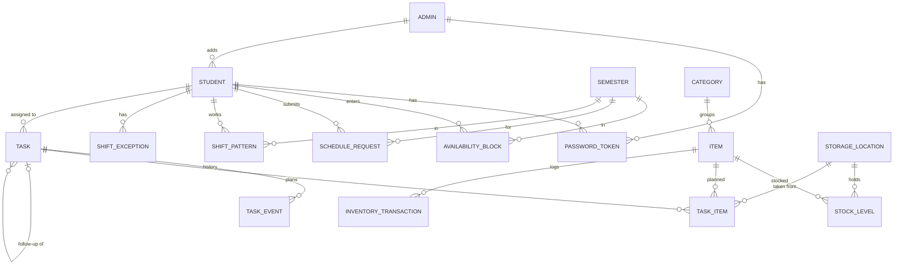

# IS&T Task Scheduler: Project Plan

A web app for the IS&T student team at Cleveland State University. Managers schedule system **deployments** and **fixes** across campus; the app assigns each one to a student who is on shift, tracks it to completion, and keeps the back-room inventory up to date.

**Stack:** Spring Boot 4 (Java 21), PostgreSQL, Angular 22.
**Status:** portfolio project running on two developer machines. It may later be deployed by the college, so choices below keep that path open (SSO, real email, hosting).

---

## 1. Roles

| Role | Can do |
|---|---|
| **Student** | Set a password from the "you've been added" email; submit class times and preferred hours; see own shifts and hours; receive, hand off, opt out of, claim and complete tasks |
| **Manager** (role `ADMIN`) | Uses the **admin portal** at `/admin`: add, disable and remove students and other admins; manage semesters and holidays; approve and edit schedules; create, reschedule and cancel tasks; manage inventory; change settings |

In the code, managers are **admins** (role `ADMIN`); "manager" in this plan means an admin. Students and admins are stored in **separate tables** (`students`, `admins`). The first admin is created by the dev seed (`application-dev.properties`); any admin can add, disable and remove students and other admins, but never themselves, so at least one active admin always remains.

The employee who receives a deployment or fix is **not** a user. Their details are stored on the task, and managers contact them outside the app for now.

---

## 2. Business rules

### 2.1 Accounts and login

1. There is **no self-registration**. An admin adds every account in the admin portal: a **student** (first name, last name, email, **student ID — required and unique**) or another **admin** (first name, last name, email). An email can belong to only one account across both tables.
2. The new user is emailed "You've been added to the IS&T portal" with a single-use **set-password link** (expires after 48 hours). No password exists before that.
3. After setting and confirming a password, the user is taken to the **login page** (with a "bookmark this page" message) and logs in with email and password.
4. **Forgot password:** the user enters their email. If a manager has added it and the account isn't disabled, a set-password link is emailed (expires after 1 hour). The page shows the same message either way. This also covers someone whose first link expired.
5. Managers see who **hasn't set a password yet**.
6. Admins can **disable** an account (can't log in, gets no new tasks, account kept) or **remove** it (deleted permanently), for students and for other admins, but not their own. Once tasks exist, removing a student with task history will need rethinking; disabling is the safe option.
7. Students log in at `/login` (user portal); the admin logs in at `/admin/login` (admin portal). A student who tries the admin login is turned away.
8. Any email address can be added for now.

### 2.2 Semesters and holidays

1. Managers create **semesters** with a type (Fall, Spring, Summer), start date and end date.
2. Each semester has a **weekly hour limit**: 20 for Fall and Spring, 40 for Summer, editable by managers.
3. Managers add **holidays** manually or by uploading an `.ics` calendar file (all-day events become holidays).
4. Holidays do **not** block anything. Shifts and tasks on a holiday show a **warning**.
5. Between semesters there are no recurring shifts. Managers can still add one-off shifts.

### 2.3 Availability and shifts

1. For each semester, a student enters:
   - **class times** (recurring weekly blocks when they definitely can't work), and
   - **preferred hours** (recurring weekly blocks they want to work).
2. Submitting the preferred hours creates a **schedule request** for managers.
3. A manager **approves** it as-is, or **edits and approves** it. The approved blocks become the student's **recurring shifts** for that semester. The student is emailed either way.
4. Managers can edit a student's recurring shifts at any time, and add **one-off changes** for a single date (cancel a shift, or add an extra one).
5. Shifts are **Monday to Friday only** and can start and end at any minute.
6. **Warnings, not blocks:** a week over the semester's hour limit; a shift on a holiday; a shift overlapping the student's class times.
7. A student's shifts on a given date = recurring shifts for that weekday (within the semester), minus cancelled one-offs, plus extra one-offs.
8. **Hours summary** (scheduled hours, not clocked hours) per day and per week, visible to the student and to managers.

### 2.4 Tasks

1. A manager creates a task: type (Deployment or Fix), title, description, start date and time, **duration** (default 30 minutes, including travel), building and room, and employee contact details (name, email, phone, department).
2. **Statuses:** Unassigned, Assigned, Completed, Could not complete, Cancelled.
3. **Eligible student** for a task: Active, has a shift that **fully contains** the task's time window, and has no other assigned task overlapping it.
4. **Automatic assignment** when a task is created (and whenever it needs a new assignee): pick the eligible student with the **fewest tasks that day**. Ties go to fewest tasks that week, then at random. The student is emailed.
5. If nobody is eligible, the task is saved as **Unassigned**, and the manager sees a warning immediately.
6. **Opt out:** the system automatically reassigns to the next eligible student. If there is none, the task becomes Unassigned and students who are on shift at any point that day are emailed that it is available to claim.
7. **Hand off:** the student picks another eligible student, and the task is assigned to them straight away. Both are emailed.
8. **Claim:** any Active student can take an Unassigned task. If they aren't on shift for the whole task, managers see a warning on it. If two students claim at the same moment, only the first succeeds.
9. **Reschedule** (managers only): if the assignee is no longer eligible at the new time, the task is reassigned automatically. Affected students are emailed.
10. **Shift edits:** if a shift change means an assigned task no longer fits, that task is unassigned and automatic assignment runs again.
11. **Complete:** the assignee marks it Completed, with optional notes and the quantity actually used of each planned item.
12. **Could not complete:** the assignee marks it with required notes. Reserved items are released.
13. **Cancel** (managers only): reserved items are released and the assignee is emailed.
14. Every change (created, assigned, opted out, handed off, claimed, rescheduled, completed, and so on) is recorded in the task's **history** with who did it and when.

### 2.5 Inventory

1. **Categories** (Laptops, Monitors, Keyboards, Cables, and so on), **items** (a specific model in a category) and **storage locations** (building and room).
2. Stock is a **count per item per location**. The same keyboard model can be stocked in several rooms.
3. Items have optional extra fields (manufacturer, model, free-form attributes). Each item has a tracking type, currently always **Count**; **Serialized** (individual asset tags and serial numbers) is reserved for later.
4. Managers add stock, remove stock and correct counts. Every change is a recorded **inventory transaction** (who, what, why, when).
5. A deployment (and optionally a fix) lists **planned items** with quantities. Each line takes stock from one location, defaulting to the location with the most available stock. A manager or the assigned student can change it.
6. Planned items are **reserved** when the task is created. Available stock = on hand − reserved.
7. If there isn't enough available stock, the task is still saved, with a **warning**.
8. On completion, the quantity used is **deducted**. Any shortfall becomes a **backorder** line on the task.
9. When a backordered item is back in stock, managers are told (see 2.6) and can create a **follow-up deployment** linked to the original, prefilled with the employee, location and missing items.
10. **Low stock:** each item has a threshold on its **total across all locations**.
11. Returns of old equipment are out of scope for now.

### 2.6 Notifications

All notifications are emails, sent through Gmail SMTP from one address (`app.mail.from`, currently `gomesalister98@gmail.com`, shown as "IS&T Portal"), whichever admin's action triggered them. Sending needs a Gmail App Password in the `GMAIL_APP_PASSWORD` environment variable; without it, emails are printed to the console instead. If sending fails, the action that triggered it is rolled back (for example, the student isn't added) and the admin sees an error.

| Event | Sent to |
|---|---|
| Added to the portal (set-password link) | The new user |
| Forgot password | The user |
| Schedule request submitted | All managers |
| Schedule approved / edited | The student |
| Task assigned, handed off, rescheduled, cancelled | Affected students |
| Task available to claim | Students on shift at any point that day |
| **Daily digest**, weekdays at 08:00 (Eastern) | Managers marked as digest recipients (one or two; chosen in settings) |

The **daily digest** contains:
- today's unassigned tasks;
- items at or below their low-stock threshold;
- backordered items that are now back in stock.

### 2.7 Settings (editable by managers)

Daily digest time (08:00), which managers receive the digest, default task duration (30 minutes). The time zone is fixed to `America/New_York`.

---

## 3. Data model

| Entity | Key fields |
|---|---|
| `Student` (table `students`) | email (unique across both tables), firstName, lastName, studentId (required, unique), status `ACTIVE`/`DISABLED`, passwordHash (null until set), createdBy (an admin) |
| `Admin` (table `admins`) | email, firstName, lastName, status, passwordHash, receivesDigest, createdBy (another admin) |
| `PasswordToken` | student **or** admin (exactly one), tokenHash, purpose `SET_PASSWORD`/`RESET_PASSWORD`, expiresAt, usedAt |
| `Semester` | name, type `FALL`/`SPRING`/`SUMMER`, startDate, endDate, weeklyHourLimit |
| `Holiday` | date, name, source `MANUAL`/`ICS_IMPORT` |
| `AvailabilityBlock` | student, semester, dayOfWeek, startTime, endTime, kind `CLASS`/`PREFERRED` |
| `ScheduleRequest` | student, semester, status `SUBMITTED`/`APPROVED`/`APPROVED_WITH_CHANGES`, reviewedBy, reviewedAt |
| `ShiftPattern` | student, semester, dayOfWeek (Mon–Fri), startTime, endTime |
| `ShiftException` | student, date, type `CANCEL`/`EXTRA`, startTime, endTime, reason |
| `Task` | type `DEPLOYMENT`/`FIX`, title, description, startAt, durationMinutes, building, room, employee contact (embedded), status, assignee, completionNotes, completedAt, createdBy, parentTask, version (for simultaneous edits) |
| `TaskEvent` | task, type, actor, fromUser, toUser, occurredAt, note |
| `TaskItem` | task, item, location, quantityPlanned, quantityUsed, status `RESERVED`/`FULFILLED`/`BACKORDERED`/`RELEASED` |
| `Category` | name |
| `Item` | category, name, manufacturer, model, trackingType `COUNT`/`SERIALIZED`, lowStockThreshold, attributes (JSON) |
| `StorageLocation` | building, room, description |
| `StockLevel` | item, location, quantityOnHand (unique per item + location) |
| `InventoryTransaction` | item, location, delta, reason `RESTOCK`/`DEPLOYMENT`/`ADJUSTMENT`/`REMOVAL`, task, actor, occurredAt, note |
| `AppSetting` | key, value |

Dates and times: task times are stored as exact instants; shifts are a weekday plus local times, read in `America/New_York`; holidays are plain dates.

---

## 4. Technical decisions

| Decision | Why |
|---|---|
| **Flyway** migrations create all tables; Hibernate is set to `validate` | Every schema change is a numbered SQL file in git, so both developers' databases stay identical. Hibernate only checks that entities match. |
| **Spring Security with a session cookie** | Simpler and safer than tokens for a browser app; replaceable with SSO later. |
| **Angular dev proxy** (`/api` → `localhost:8080`) instead of CORS | Frontend and backend look like one site, so the session cookie and CSRF protection work without extra setup. `WebConfig` (CORS) is removed. |
| **All pages render in the browser, not on the Angular server** | Pages depend on who is logged in, which the server can't know when prerendering. Server rendering mainly helps search engines and first load, neither of which matters for an internal tool. |
| **Email behind an interface**: Gmail SMTP when `GMAIL_APP_PASSWORD` is set, console otherwise (`EmailConfig`) | Business code never changes when the sending method does; anyone without the sending account's credentials can still run the app. |
| **Spring profiles** `dev` (seed data, console email) and later `prod` | A fresh clone works immediately. |
| **Packages by feature**: `auth`, `user`, `calendar`, `schedule`, `task`, `inventory`, `notification`, `common` | Each feature has its own entities, repositories, services, controllers and DTOs. |
| **DTOs in controllers**, never entities | No password hashes in responses; tables can change without changing the API. |
| **Errors as `ProblemDetail`** (standard JSON error format) | One consistent error shape for the frontend to handle. |
| **Warnings returned alongside results** | Rules that "warn, not block" come back as a `warnings` list in the response for the frontend to show. |
| **Optimistic locking** (`@Version`) on `Task` | Two students claiming at once: the second gets a clear error instead of silently overwriting. |
| **`@Scheduled` job** for the daily digest | Built into Spring; no extra infrastructure. |
| **Tests:** unit tests for rules (assignment especially); integration tests against a local `isandt_test` PostgreSQL database | Docker isn't available, so no Testcontainers. |

**Dependencies to add:** `spring-boot-starter-security`, `spring-boot-starter-mail`, `spring-boot-starter-flyway` + `flyway-database-postgresql`, (`.ics` files are read by a small built-in parser, `IcsHolidayParser`, instead of a library).

---

## 5. API outline

All under `/api`. *(M)* = managers (role `ADMIN`) only.

**Auth:** `POST /auth/login` · `POST /auth/logout` · `GET /auth/me` (204 when nobody is logged in; also issues the CSRF cookie) · `POST /auth/set-password` · `POST /auth/forgot-password`

**Admin portal:** `GET|POST /admin/students` · `POST /admin/students/{id}/disable` · `DELETE /admin/students/{id}` · `GET|POST /admin/admins` · `POST /admin/admins/{id}/disable` · `DELETE /admin/admins/{id}` (all *(M)*; POST emails the set-password link)

**Calendar:** `GET|POST /semesters` · `PUT|DELETE /semesters/{id}` *(M)* · `GET|POST /holidays` · `DELETE /holidays/{id}` *(M)* · `POST /holidays/import` *(M, .ics upload)*

**Schedule:**
- `GET|PUT /me/availability?semesterId=` · `POST /me/schedule-requests`
- `GET /schedule-requests?status=` *(M)* · `POST /schedule-requests/{id}/approve` *(M, optional edited blocks)*
- `GET|PUT /students/{id}/shifts?semesterId=` *(M)* · `POST /students/{id}/shift-exceptions` *(M)*
- `GET /shifts?from=&to=` (team calendar) · `GET /me/hours?week=` · `GET /students/{id}/hours?week=` *(M)*

**Tasks:**
- `GET /tasks?from=&to=&status=&assignee=` · `GET /tasks/{id}` (with history)
- `POST /tasks` *(M)* · `PUT /tasks/{id}` *(M, edit/reschedule)* · `POST /tasks/{id}/cancel` *(M)*
- `POST /tasks/{id}/claim` · `POST /tasks/{id}/opt-out` · `POST /tasks/{id}/hand-off` · `POST /tasks/{id}/complete` · `POST /tasks/{id}/not-completed`
- `GET /tasks/{id}/eligible-students`
- `POST /tasks/{id}/follow-up` *(M, from backorders)*

**Inventory:** `GET|POST /categories` · `GET|POST /items` · `PUT /items/{id}` · `GET|POST /locations` · `GET /stock?itemId=&locationId=` · `POST /stock/adjust` *(M)* · `GET /inventory/transactions` *(M)* · `GET /inventory/low-stock` *(M)* · `GET /inventory/backorders` *(M)*

**Settings:** `GET|PUT /settings` *(M)*

---

## 6. Frontend pages

| Area | Pages |
|---|---|
| Public | Login (exists), Set password, Forgot password |
| Student | Dashboard (today's tasks, this week's hours), My schedule (class times, preferred hours, approved shifts), Tasks (list and detail with actions), Account (exists) |
| Manager (admin portal, `/admin`) | Admin login (`/admin/login`), Users (`/admin`: Students and Admins tabs, add, disable, remove), Semesters and holidays, Schedule requests, Team schedule (week view and hours), Task calendar (create, edit, reschedule), Inventory (items, locations, stock, transactions, low stock, backorders), Settings |

Existing pages `contact` and `logout` stay. Route guards hide manager pages from students; the backend enforces the same rules regardless.

---

## 7. Build phases

Each phase works end to end (database → API → Angular) before the next starts. One branch and one PR per phase.

Within a phase, each feature is built in this order:

1. **Migration**: the Flyway SQL file that creates or changes the tables
2. **Entity**: maps the table; Hibernate checks it against the migration at startup
3. **Repository**: database queries
4. **Service**: the business rules from section 2, with unit tests
5. **DTOs and controller**: the API endpoints
6. **Angular**: service method, then the page

The feature is done when it works from the Angular page through to the database.

### Phase 0: Foundation ✅
- Flyway dependency and migration folder; Hibernate set to `validate`; database settings overridable per developer
- Global error handling (`ProblemDetail`, with field errors for validation)
- Email interface with the console implementation
- Angular: dev proxy, `WebConfig` (CORS) removed, all routes rendered in the browser

### Phase 1: Accounts and login ✅
- `User`, `PasswordToken`; manager-added users, set and forgot password, login/logout, `me`, disable (self-registration was built, then replaced by manager-only accounts in migration V2)
- Spring Security: session login, CSRF, role checks
- `dev` profile with seed data: one manager account (needs the users table, so it lands here)
- Angular: switch page navigation to the Angular Router (email links such as `/set-password?token=…` need real URLs); login (wire up existing page), set password, forgot password, users (admin portal); route guards; HTTP error handling

The warnings response shape is built in phase 2, when the first warn-not-block rule needs it.

### Phase 2: Semesters, holidays and schedules
- `Semester`, `Holiday` (+ `.ics` import), `AvailabilityBlock`, `ScheduleRequest`, `ShiftPattern`, `ShiftException`
- Shift calculation for any date; hour summaries; warnings
- Angular: semesters and holidays, my schedule, schedule requests, team week view

### Phase 3: Tasks
- `Task`, `TaskEvent`; eligibility and automatic assignment; claim, opt out, hand off, reschedule, cancel, complete, could not complete
- Re-assignment after shift edits; task emails
- Angular: task calendar (manager), task list and detail (student), dashboard

### Phase 4: Inventory
- `Category`, `Item`, `StorageLocation`, `StockLevel`, `InventoryTransaction`, `TaskItem`
- Reservations, deduction on completion, backorders, follow-up deployments
- Angular: inventory pages; planned items on the task form and on completion

### Phase 5: Daily digest and polish
- 08:00 weekday digest (unassigned tasks, low stock, backorders back in stock)
- Settings page; history views; seed data for a realistic demo

---

## 7b. Admin portal build (agreed Oct 2026)

The admin side is built first; student pages only where the admin side can't work without them.

| Step | Contents | Status |
|---|---|---|
| 1 | Layout (sidebar, tables, side panels, styled confirm dialogs, toasts); Users: edit, resend set-password link, enable, search/filter/sort; My account (name, password) | ✅ |
| 2 | Dashboard skeleton (accounts at a glance, current semester, next holiday) | ✅ (fills in as features land) |
| 3 | Calendar: semesters (no overlaps, hour limit) and holidays (manual ranges, `.ics` import) | ✅ |
| 4 | Inventory: categories, rooms, items (extra details as JSON), stock per room with add/remove/set and history, archive, low stock | ✅ |
| 5 | Schedules: student availability form (user portal), requests and approval, weekly shifts, one-off days off / extra shifts, team week view, warnings (hour limit, classes, holidays) | ✅ |
| 6 | Tasks: week board, list, create/edit/reschedule/cancel, auto-assignment, manual assignment, item reservations, history, backorders and follow-ups; student Tasks page (claim, opt out, hand off, complete, couldn't complete) | ✅ |
| 7 | Settings (digest time and recipients, default task length) and the weekday digest email (scheduled job, "send now") | ✅ |

## 7c. User (student) portal build (agreed Oct 2026)

Phone-first: students use it between buildings.

| Item | Contents | Status |
|---|---|---|
| A | Layout: phone tab bar (Home, Tasks, Schedule, More), wider pages for Tasks/Schedule, shared notices and dialogs | ✅ |
| B | Home "my day": next task with countdown, today's shifts and tasks, week hours vs limit, up for grabs, hours request status | ✅ |
| C | Tasks: grouped by day, expandable details (tap to call/email, items to pick up), "only during my shifts" filter | ✅ |
| D | Schedule: My week view; hours by week for the semester | ✅ |
| E | My account (name, password) shared with the admin portal | ✅ |
| F1 | Time off: students ask for a whole day, one shift or some hours; admins approve/decline; on approval, tasks in that time go to someone free and on shift, and any nobody can take become unassigned and are reported to the admin | ✅ |
| F2 | Inventory: read-only stock lookup for students (what's free, which room) | ✅ |
| F3 | Contact page removed | ✅ |
| F4 | Calendar subscription: private .ics link per student (shifts and tasks, 2 weeks back to 8 ahead), regenerate to revoke | ✅ |

## 8. Open questions

1. **Which managers receive the daily digest?** To be decided; it's a setting, so it can be changed at any time.

## 9. Later (out of scope now)

CSU single sign-on · emailing employees from the app · restricting accounts to CSU email domains · serialized asset tracking · returns of old equipment · hosting (and a CSU-owned sending address) · in-app notifications.
